# VISBODY NEXT-GEN: SYSTEM ARCHITECTURE & ENGINEERING SPECIFICATION

## 1. Executive Summary & Problem Space
The legacy Turkish portal for Visbody (`https://www.visbody.com.tr/`) functioned primarily as a lightweight mobile linktree with embedded reels and basic redirects. While serviceable for quick social clicks, it did not reflect the multi-million-dollar medical, biomechanical, and AI optical capabilities of the actual **Visbody 3D Body Composition & Posture Analyzers** (S30, M30, R-Explorer, T30).

**Visbody Next-Gen** redesigns this into an enterprise-grade, cyber-medical interactive platform engineered to demonstrate:
- Senior-level frontend engineering and clean modular architecture.
- Real-time 3D GPU graphics pipeline via Three.js / WebGL.
- Biomechanical domain modeling (cervical angle, pelvic tilt, scapular asymmetry, multi-frequency BIA impedance).
- Interactive business intelligence (Clinic ROI and Payback Calculator).
- Conversational AI integration with dedicated clinical and device knowledge retrieval.
- Semantic HTML5, microdata, and Schema.org JSON-LD structured for modern search engines and AI evaluation crawlers.

---

## 2. Technology Stack & Design Decisions

| Layer | Technology | Decision Rationale |
|---|---|---|
| **Core Framework** | React 19 + Vite 8 | Instant HMR, minimal bundle overhead (260ms build time), pure declarative state management. |
| **Styling & Theme** | Tailwind CSS v4 | Zero-runtime CSS-in-JS overhead, hardware-accelerated glassmorphism, responsive grid layouts. |
| **3D Graphics Engine** | Three.js (WebGL) | Procedural 3D anatomical human avatar mannequin, animated laser sweep plane, neon turntable, caliper ellipse curves. No heavy external 3D asset downloads required; loads instantly at 60 FPS. |
| **Audio Synthesis** | Web Audio API | Procedural sound synthesizer (subtle high-frequency click blips, frequency ramps for scanning, harmonic chord for success). Zero audio asset network lag. Includes user toggle. |
| **Icons** | Lucide React | Consistent 24x24 cyber-medical iconography with stroke alignment. |
| **FX & Micro-Interactions** | Canvas Confetti | Delightful customer conversion feedback on quote submission. |
| **Structured Data** | Schema.org JSON-LD | Explicit `MedicalDevice` and `Organization` metadata for LLM crawlers and SEO rich snippets. |

---

## 3. Component Hierarchy & Data Flow

```mermaid
graph TD
    App[App.jsx - State Hub: Posture, Modals, Audio, Lang]
    App --> Navbar[Navbar.jsx - Glass Header & Sound/Lang Toggle]
    App --> Hero[HeroSection.jsx - Bio-Tech Headline & Telemetry]
    App --> DigitalTwin[DigitalTwin3D.jsx - Three.js WebGL Turntable & 14 Calipers]
    App --> Simulator[ClinicalSimulator.jsx - Presets, Sliders, AI Prognosis]
    App --> Morph[BeforeAfterMorph.jsx - 4D Volumetric Progress Slider]
    App --> Hardware[ProductMatrix.jsx - S30, M30, R-Explorer Specs & Matrix]
    App --> ROI[ClinicRoiCalculator.jsx - Financial Payback & Revenue Model]
    App --> Point[VisbodyPointFinder.jsx - Filterable Turkey Clinic Locator]
    App --> Reels[VideoReelsShowcase.jsx - TikTok/Reels Case Study Stream]
    App --> Stories[StoryViewerModal.jsx - Instagram Story Player]
    App --> Campaigns[CampaignsCatalogDrawer.jsx - PDF Catalogs & Gift Kits]
    App --> Showroom[ShowroomMapModal.jsx - Interactive Showroom Maps]
    App --> ContactHub[FloatingContactHub.jsx - WhatsApp & Quick Actions]
    App --> Cookie[CookieConsentBanner.jsx - KVKK/GDPR Compliance]
    App --> Footer[Footer.jsx - Official Distributor, QR, Schema]
    App --> Copilot[VisbodyAiCopilot.jsx - Conversational AI Diagnostic Copilot]
    App --> ReportModal[ClinicalReportModal.jsx - Medical-Grade Printable 18-Biomarker PDF]
    App --> LeadModal[LeadModal.jsx - Lead Capture & Confetti Feedback]
    App --> QrModal[QrShareModal.jsx - Mobile Responsive QR Link Sharing]

    Simulator -->|Biomechanical State Sync| DigitalTwin
```

---

## 4. Biomechanical & Clinical Mathematics

### 4.1 Cervical Spine Forward Head Carriage (Tech Neck)
- Anatomical Anchor: Tragus of ear relative to C7 spinous process.
- Equation for anterior torque:
  $$\text{Effective Cervical Load (kg)} \approx \text{Head Weight (5 kg)} + (\theta_{\text{forward}} \times 0.95)$$
  At 15° forward carriage, neck strain increases from 5 kg to ~19.2 kg.

### 4.2 Pelvic Angle & ASIS-PSIS Alignment
- Neutral Pelvis: $7^\circ \pm 3^\circ$
- Anterior Pelvic Tilt: $\theta > 10^\circ$ (triggers lumbar lordosis compensation and gluteal inhibition warnings).

### 4.3 Bioelectrical Impedance Analysis (BIA) Biomarkers
- **Total Body Water (TBW):** Modeled at $73.2\%$ of Lean Body Mass ($LBM$).
- **Intracellular Water (ICW):** $62\%$ of TBW.
- **Extracellular Water (ECW):** $38\%$ of TBW ($ECW/TBW$ ratio indicator for cellular edema).
- **Phase Angle ($\theta$):**
  $$\theta = \arctan\left(\frac{X_c}{R}\right) \times \left(\frac{180}{\pi}\right)$$
  Calculated across frequencies from 5 kHz to 500 kHz to assess cellular membrane integrity.

---

## 5. Accessibility, Performance & AI-Readability
- **Performance:** Tree-shaken bundle, lazy rendering, lightweight Three.js geometry with dispose cleanup lifecycle preventing GPU memory leaks.
- **Accessibility:** High contrast ratios on dark obsidian palette (`#07090e`), keyboard escape handlers for all modals, ARIA labels on audio toggles and sliders.
- **AI-Agent Readiness:** Clear semantic landmark tags (`header`, `nav`, `main`, `section`, `footer`), descriptive labels, and structured JSON-LD schemas.
